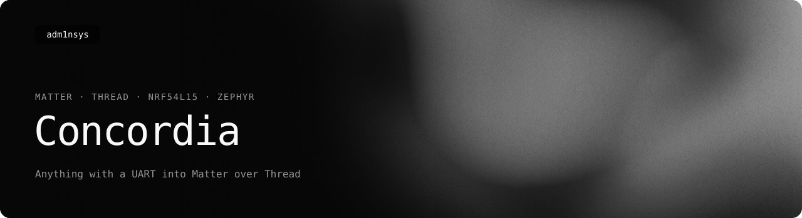

<picture>
  <source media="(prefers-color-scheme: light)" srcset=".github/readme/banner-light.svg">
  
</picture>

<p>
  <a href="https://adm1nsys.github.io/Concordia/"></a>
  <a href="https://adm1nsys.github.io/Concordia/#versions"></a>
  <a href="#license"></a>
</p>

**A bridge from anything into Matter over Thread, built on a single
microcontroller — no Linux, no Raspberry Pi, no hub computer.**

An nRF54L15 runs the Matter/Thread stack and hosts a table of virtual
accessories — temperature, humidity, lights, plugs, locks, thermostats and
over 30 more types. Whatever can write a line of text to a serial port can
create them and feed them values: another microcontroller, a computer, a
script, or a person typing into a terminal. Apple Home, Google Home, Amazon
Alexa and any other Matter controller see real accessories on the Thread
network.

## How it works

```
 any data source                 UART / USB serial                 Thread / 802.15.4
 ───────────────                 line-based shell                  ─────────────────
 ESP32 polling HTTP APIs   ─┐                         ┌──────────┐                     Apple Home
 another microcontroller   ─┼──  bridge set 4 2137  ──│ nRF54L15 │ <─────────────────> Google Home
 a script on a computer    ─┤                         │  bridge  │                     Alexa, …
 you, in a terminal        ─┘                         └──────────┘
```

- **The nRF54L15 is the bridge.** It runs the full Matter/Thread stack (nRF
  Connect SDK on Zephyr) and is the thing your phone commissions — it
  advertises, pairs and answers Matter traffic on its own, exactly like a
  commercial accessory. Its endpoints are virtual: they are not tied to any
  hardware on the board, and they stay across reboots.
- **The input is a plain line protocol** on the board's serial shell. The
  same commands work from a program and from a human on a cable; there is no
  binary format or SDK to link against.
- **Where the data comes from is up to you.** This repository ships one
  complete source: an ESP32-C6 with Wi-Fi and a web panel that pulls values
  from HTTP APIs. It was simply the board at hand — anything with a 3.3 V
  UART, or a computer on the USB port, does the same job.

## Feeding it data

115200 baud, one command per line, prompt `uart:~$`. A bare `bridge` prints
the menu.

| Command | |
| --- | --- |
| `bridge types` | endpoint types that can be added, with the value format of each |
| `bridge add <type> <name>` | create an endpoint, e.g. `bridge add temp "Outside"` |
| `bridge set <id> <value> [level] [mireds]` | update it, e.g. `bridge set 4 2137` → 21.37 °C |
| `bridge list` | all endpoints with their current values |
| `bridge remove <id>` | delete one |
| `bridge status`, `bridge pairing` | runtime state; the manual code and QR payload |
| `bridge commission` | open the commissioning window (BLE advertising) |
| `bridge reboot`, `bridge factoryreset confirm` | restart; erase fabrics and endpoints |

Values are integers in the unit the Matter cluster uses (centi-degrees for
temperature, `1`/`0` for on/off, `0-254` for a level); `bridge types` shows
the format and an example for every type. Changes made in a controller —
switching a light in Apple Home — are written back to the endpoint, so the
data source can read them with `bridge list`.

## Boards

| Role | Board | Status |
| --- | --- | --- |
| Bridge | **nRF54L15 DK** | ✅ Shell on the DK's USB serial port — a computer can drive it directly |
| Bridge | **Seeed XIAO nRF54L15 (Sense)** | ✅ Shell on the header pins (`P2.08` TX, `P2.07` RX), logs stay on USB. Not an official Nordic target, hand-ported — see [`PORTING_NOTES.md`](nRF54l15_Bridge/PORTING_NOTES.md) |
| Bridge, likely portable | nRF52840 DK, nRF5340 DK, nRF54L15 Tag, nRF54LM20 DK | 🧪 Supported by Nordic's Matter Template the firmware is built on; untested |
| Data source | **Seeed XIAO ESP32-C6** with [`concordia-hub-esp`](concordia-hub-esp) | ✅ The companion in this repository |
| Data source | anything with a 3.3 V UART, or a computer over USB | ✅ Only needs to send text lines |

Only Matter **over Thread** — the bridge needs an 802.15.4 radio; Matter over
Wi-Fi is not used.

## The ESP32-C6 companion

One ready-made data source, so the bridge is useful without writing any code:

- **Generic HTTP → Matter**: any URL that answers JSON, a path into it and a
  scale factor. Add a device in the panel, point it at a URL, and it shows up
  in Apple Home.
- **Admin web panel** served from an SD card — multi-user with per-user
  permissions, sessions, a first-run setup wizard. Can be developed in a
  browser with no hardware at all: [`concordia-web/README.md`](concordia-web/README.md).
- **Wi-Fi management** from the panel, with a captive portal for recovery;
  an **mDNS hostname** so the panel stays reachable after a network change.
- **Warnings and logs** written to the card, surviving reboots.
- **Pairing code and QR** in the panel before the bridge has ever been paired.

Wiring to the XIAO nRF54L15 (both 3.3 V, common ground):
`nRF P2.08 → ESP D3`, `nRF P2.07 ← ESP D2`, `GND — GND`.

## Pairing

The admin panel shows the manual code and QR as soon as it's ever had a
working line to the node — see "Deferred-BLE pairing" above. This build's
identity is fixed at compile time, not generated per boot, so as shipped
it's always:

```
manual: 3497-011-2332
qr:     MT:06PS042C00KA0648G00
```

**If the node isn't advertising** (the panel has the code, but Apple
Home/Google Home/Alexa never finds anything to pair with): press the node's
**USR button once, briefly**. That directly opens the commissioning window
on the node itself, independent of the ESP32 link entirely — the most
reliable fallback there is. Don't hold it down: a long press is this same
button's factory-reset trigger.

## Build and flash

- **Bridge:** nRF Connect SDK 3.4.0, `west build -b xiao_nrf54l15/nrf54l15/cpuapp --sysbuild`
  (or the DK's board name), in [`nRF54l15_Bridge/`](nRF54l15_Bridge). On the
  XIAO flash with `./flash_xiao.sh <builddir>`, not a plain `west flash` — it
  works around an OpenOCD bug that drops the last RRAM word.
- **ESP32-C6 companion:** `arduino-cli` with `esp32:esp32:XIAO_ESP32C6:PartitionScheme=huge_app`,
  in [`concordia-hub-esp/`](concordia-hub-esp).
- **Panel:** [`concordia-web/pack.py`](concordia-web/pack.py) packs it and
  uploads it to the board.

Status, open work and exact details: [`concordia-hub-esp/ROADMAP.md`](concordia-hub-esp/ROADMAP.md).

## Repository layout

```
nRF54l15_Bridge/     the bridge — nRF Connect SDK / Zephyr, Matter over Thread
concordia-hub-esp/   ESP32-C6 companion firmware — Arduino
concordia-web/       the companion's admin panel — plain HTML/JS/CSS, no build step
```

The bridge firmware is built on Nordic's **Matter Template** sample from the
nRF Connect SDK. The bridge itself — virtual endpoints, the `bridge …` shell,
storage — is this project's; commissioning, the Matter/Thread stack and the
board's button and LED handling come from the template.

## License

- `concordia-hub-esp/` and `concordia-web/`: [MIT](LICENSE).
- `nRF54l15_Bridge/`: [Nordic 5-Clause](nRF54l15_Bridge/LICENSE), inherited
  from the Matter Template — free to use and change, but only on Nordic
  Semiconductor chips.
